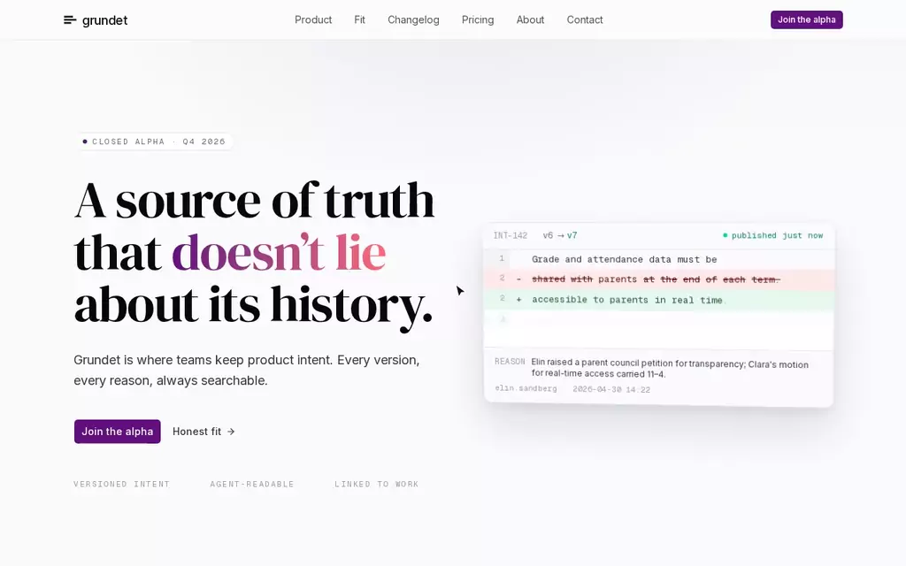
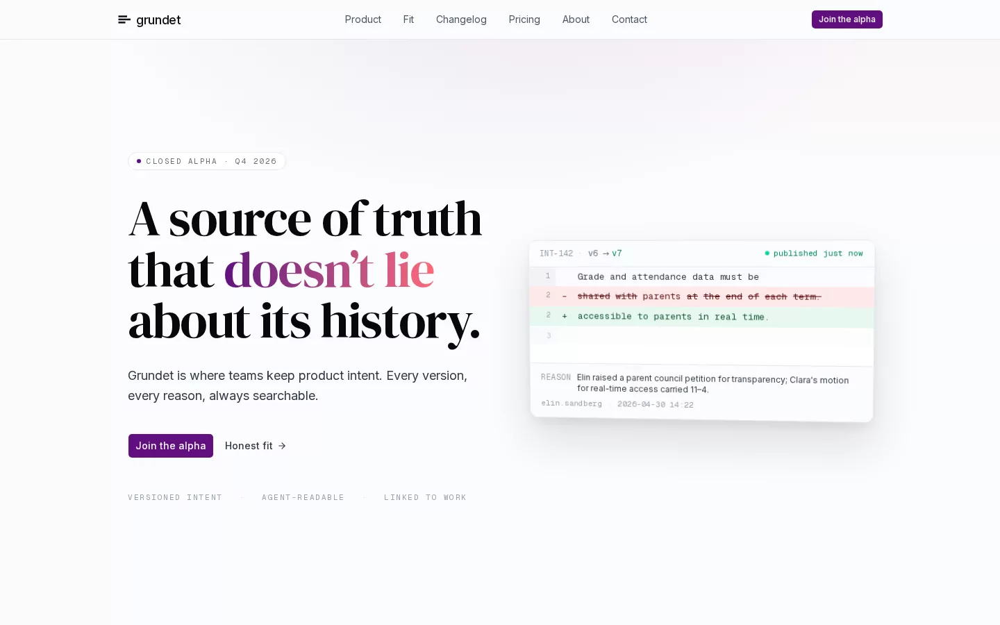
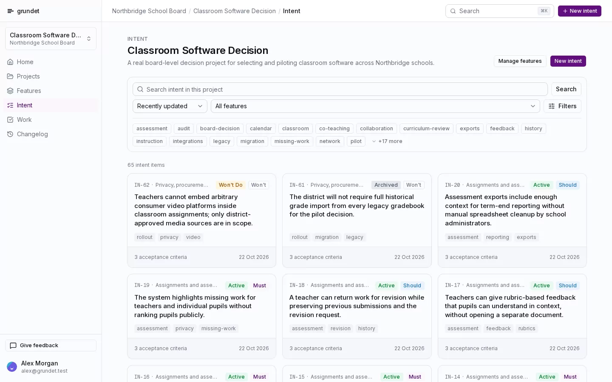
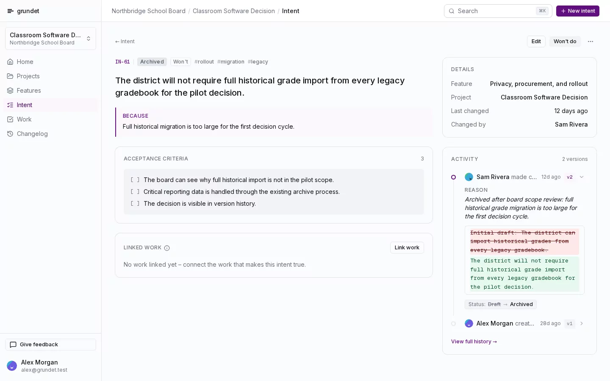
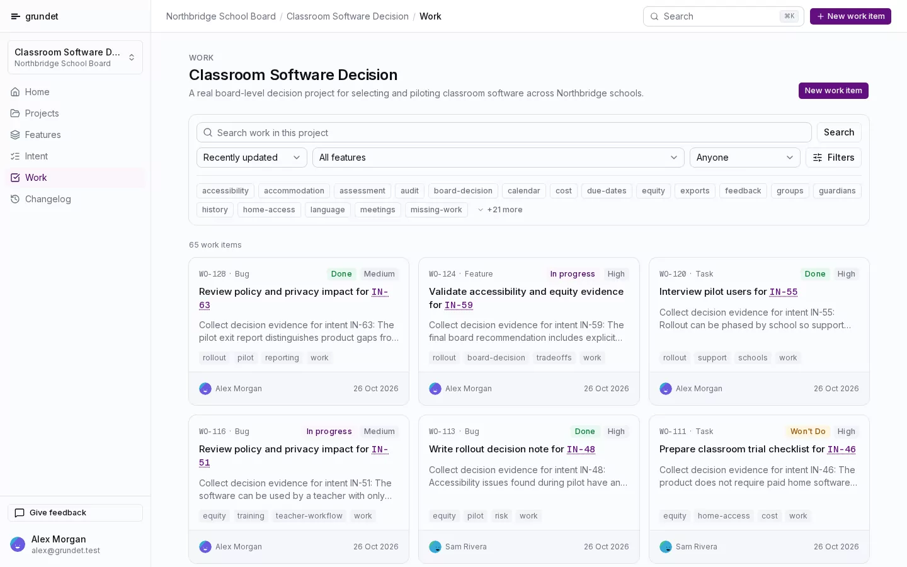
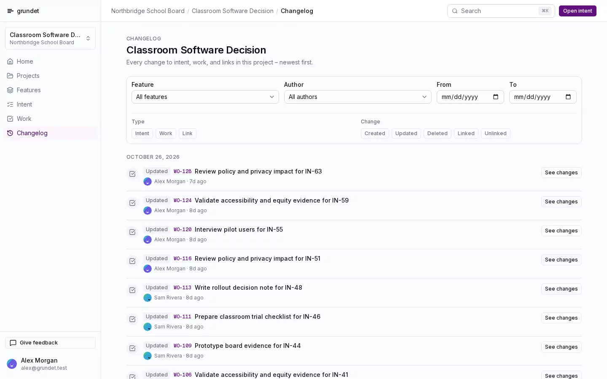
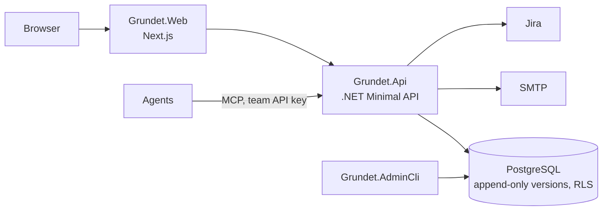

# Grundet

Grundet keeps product intent under version control. Each change to a requirement or work item is a new version. A change can include a reason. People use the web application. Agents read the same data through MCP.

> **Notice:** Grundet was an early AI engineering and agent-driven learning project. I no longer pursue it. It is not for actual use. The source code is view only: see [LICENSE](LICENSE).

[Watch as MP4 with player controls](docs/images/grundet-demo.mp4) (1 min)

The application images show fictional data from the repository's [seed scripts](scripts/db/scenarios/demo).

## Screens

| Intent list | Intent details |
| --- | --- |
|  |  |

| Work items | Changelog |
| --- | --- |
|  |  |

## Architecture

Requirements, work items, and links are never updated in place. A change inserts a new version. See [docs/architecture.md](docs/architecture.md) and the [decision records](docs/adr).

## Agent-driven development

The repository includes the setup for the coding agents:

- [AGENTS.md](AGENTS.md): project rules
- [.agents/skills](.agents/skills) and [.pi/skills](.pi/skills): task instructions
- [.pi/checks](.pi/checks): automated checks

Some of these files refer to internal documents that are not in this repository.

## Stack

C# / .NET 10, Next.js 16, shadcn/ui, Tailwind CSS, PostgreSQL, Model Context Protocol.

## License

All rights reserved. View only. Not open source. See [LICENSE](LICENSE).
